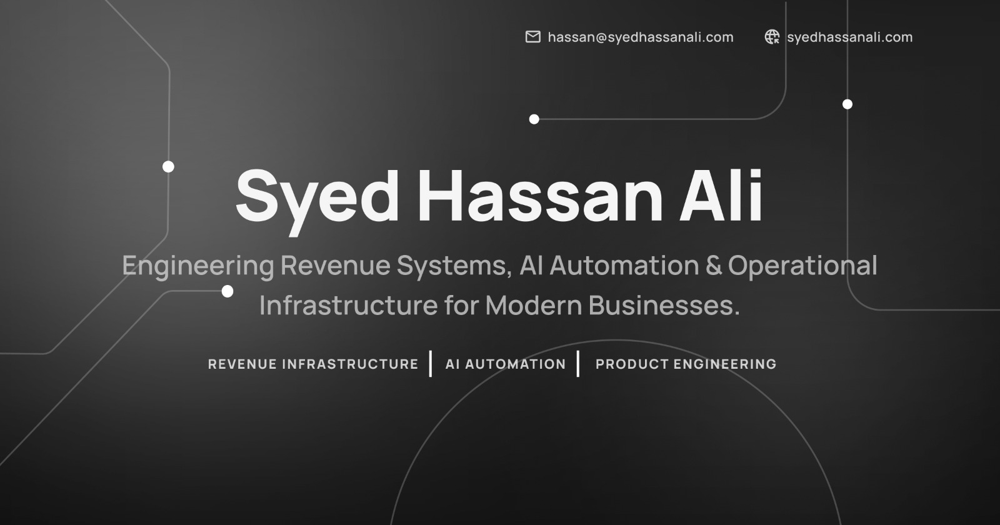

# Syed Hassan Ali

### AI Automation, Revenue Systems & SaaS Engineering

Engineering Revenue Systems, AI Automation & Operational Infrastructure for Modern Businesses.

---

## About

I design and engineer scalable revenue systems, AI automation workflows, SaaS platforms, and operational infrastructure for modern businesses.

My work focuses on building systems that automate execution, streamline operations, improve visibility, and create scalable foundations for long-term growth.

From CRM infrastructure and outbound systems to AI-powered workflows, internal platforms, backend systems, and operational tooling — every solution is built with a systems-first approach focused on scalability, maintainability, and real-world execution.

---

## Core Areas

### Revenue & Operations Systems Engineering
Design and build CRM infrastructure, outbound systems, sales automation, operational dashboards, workflow orchestration, API integrations, and scalable business operating systems.

### AI Automation & Workflow Systems
Build AI-powered workflows, intelligent automation systems, operational agents, business process automation, and execution pipelines.

### SaaS & MVP Product Development
Develop scalable SaaS platforms, MVPs, backend systems, APIs, internal tools, and production-ready software products.

---

## Technology Focus

- AI Automation
- Revenue Systems
- Workflow Engineering
- CRM Infrastructure
- SaaS Engineering
- Backend Systems
- API Integrations
- Operational Infrastructure
- Business Automation
- Workflow Orchestration
- GTM Systems
- Internal Platforms

---

## Current Focus

- Revenue Infrastructure
- AI Workflow Automation
- Operational Platforms
- Internal Business Systems
- SaaS & MVP Engineering
- Workflow Orchestration
- Automation Infrastructure

---

## Connect

- Website: https://syedhassanali.com
- Email: hassan@syedhassanali.com
- LinkedIn: https://linkedin.com/in/syeddhassannaali

---

> Systems-first engineering focused on automation, scalability, operational efficiency, and long-term business infrastructure.